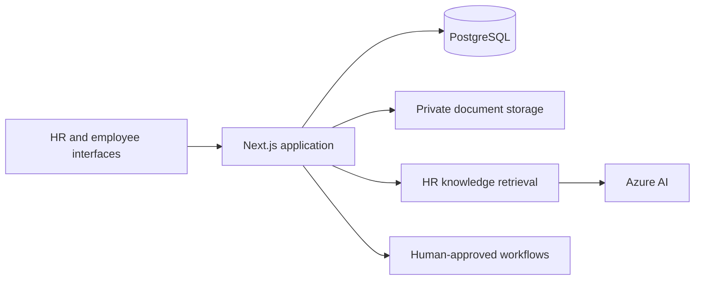

# HR Workforce Platform

LaidBackHR.ai brings employee records, approvals, workforce analytics, and an AI assistant into one HR workspace. Employees use a separate portal backed by the same records and access controls.

[HR workspace](https://www.laidbackhr.cloud) · [Employee portal](https://employee.laidbackhr.cloud) · [Technical reference](docs/reference.md)

## What it does

- Manages people, onboarding, leave, learning, equipment, and offboarding.
- Gives employees a place to submit requests and follow their progress.
- Builds workforce reports from the operational PostgreSQL database.
- Retrieves HR guidance and prepares AI-assisted workflows for human approval.
- Exposes a scoped integration API and read-only MCP tools.

The hosted application requires an authorized account. For a local walkthrough, use a disposable database and the development preview described below.

## Design decisions

The Next.js application owns the UI and server-side domain services. PostgreSQL is the system of record; the employee portal and HR workspace read the same data. Azure hosts the application, document storage, search, and AI integrations.

AI prepares or explains work through the same access controls as the rest of the application. The historical attrition model supports review and validation; it does not make employment decisions.



## Run locally

Requirements: Node.js 22.13+, pnpm 11.20.0, and PostgreSQL 16. Python is needed only for model development.

```sh
git clone https://github.com/pranavreddyg17/hr-workforce-platform.git
cd hr-workforce-platform
pnpm install --frozen-lockfile
cp .env.local.example .env.local
createdb laidbackhr
pnpm dev
```

Set `DATABASE_URL` to your local database and generate `AUTH_SECRET` with `openssl rand -base64 32`. The example uses local database credentials that may need changing on your machine. Set `SEED_DEMO_DATA=true` only for a disposable database. The schema initializes on first database access.

`LOCAL_UI_PREVIEW=true` is a development-only actor fallback. Never enable it in production. Azure services are optional for basic local development; document storage and cloud AI features need their own configuration.

## Check changes

```sh
pnpm test:priority
pnpm test:onboarding
pnpm test:pagination
pnpm test:insights
pnpm test:knowledge
pnpm lint
pnpm exec tsc --noEmit
pnpm build
```

Database, live API, and model checks have additional setup. See [validation](docs/reference.md#validation) before running them.

## Repository map

| Directory | Purpose |
| --- | --- |
| `app/` | Routes, APIs, and employee portal |
| `components/` | Workspace interfaces |
| `lib/server/` | Authorization, domain logic, integrations, and persistence |
| `db/postgres/` | Database migrations |
| `backend/` | Model training, metadata, and tests |
| `knowledge/` | HR guidance used by retrieval |
| `infra/` | Azure infrastructure |
| `tests/` | Unit and integration checks |

## Further reading

- [Architecture and Azure services](docs/reference.md#architecture)
- [AI, retrieval, agents, and MCP](docs/reference.md#ai-rag-agents-and-mcp)
- [Configuration](docs/reference.md#configuration)
- [Deployment and operations](docs/reference.md#deployment)
- [Historical attrition model card](backend/MODEL_CARD.md)

## Status and reuse

This is an actively developed application. Access to the hosted workspace is restricted, and local setup does not provision Azure resources. No open-source license is currently granted for the application source; dependencies retain their own licenses.
